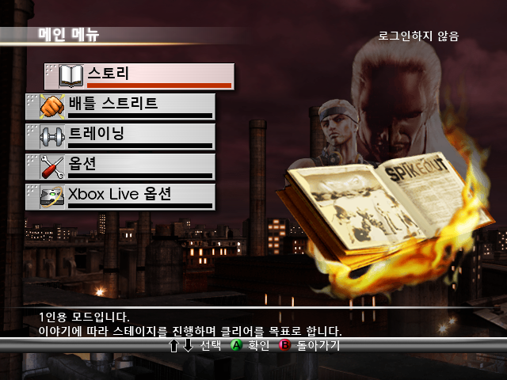
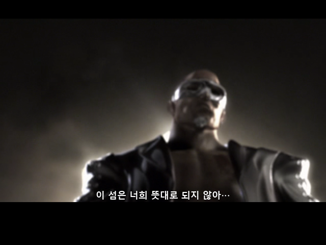
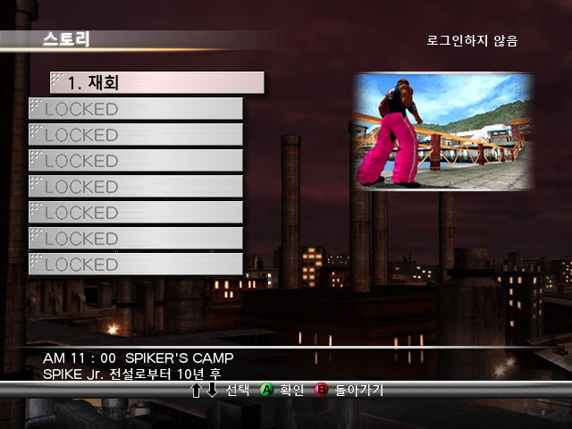

# XBOX-Spikeout-Battle-Street-Kr

**스파이크아웃: 배틀 스트리트 일본판 한국어 패치 v0.8**

일본어 텍스트, UI와 영상 자막을 한국어로 바꿉니다. 공백은 반각을 사용하며, 원래 영어로 제공되는 문구와 음성·영상 스트림은 유지합니다.

## 실행 환경 — 먼저 확인해주세요

> **현재 정상적인 실행을 확인한 에뮬레이터 환경은 릴리스에 별도로 첨부한 Android 전용 개조판입니다. 공식 hakuX 1.3.0과 다릅니다.**
>
> **PC 에뮬레이터에서도 정상 플레이를 확인하지 못했습니다.** PC에서 제목 화면이나 일부 영상이 나오는 것과 정상 플레이는 다릅니다. PC용 실행 지원으로 안내하지 않습니다.
>
> **기기와 GPU에 따라 별도의 호환 그래픽 드라이버가 필요할 수 있습니다.** 첨부 APK에는 테스트에 사용한 Turnip 26.0.0-R8이 들어 있으며, 지원되는 Qualcomm Adreno 환경에서 처음 실행할 때 적용합니다. 다른 GPU에서의 실행을 보장하지 않습니다.

첨부 APK는 **hakuX 1.3.0 기반 드라이버 개조판**입니다. 원본 hakuX의 공식 배포판이 아닌 이 게임용 별도 빌드이며, 실행 파일 로드 제한 수정과 드라이버 구성을 함께 적용했습니다. 확인 환경은 Android 13 / Adreno 740입니다. ARM64 Android 9 이상이 필요하며, 이 조건만으로 모든 기기의 호환성을 보장하지는 않습니다.

PC나 다른 에뮬레이터에서 플레이하려면 **해당 게임의 호환성을 개선한 후속 에뮬레이터 버전을 기다려주세요.** 대안으로 패치 실행이 가능한 Xbox 실기를 사용할 수 있으나, **실기 구동은 이번 작업에서 검증하지 않았습니다.**

## 다운로드와 패치

[v0.8 릴리스 다운로드](https://github.com/OldManCraveGuitars-bit/XBOX-Spikeout-Battle-Street-Kr/releases/tag/v0.8)

1. Windows에서 `Spikeout-Battle-Street-Kr-Patcher-v0.8.exe`를 실행합니다. Python 설치는 필요 없습니다.
2. 일본판 원본 ISO/XISO와 새 파일을 저장할 위치를 선택합니다. 원본 게임 파일 6,316개를 검사한 뒤 별도의 한국어 XISO를 만듭니다.
3. Android 기기에 **별도 첨부된** `hakuX-Spikeout-KR-1.3.0-v0.8.apk`를 설치합니다.
4. 새 한국어 XISO를 기기로 옮기고, 앱에서 게임 폴더를 선택해 실행합니다.

게임은 일본어 언어 슬롯에 들어 있는 한국어 데이터를 자동 선택합니다. 게임의 언어를 별도로 한국어로 설정할 필요가 없습니다. hakuX 앱 자체의 설정 화면과 원래 영어였던 `PRESS START` 등의 문구는 영어입니다.

본인이 보유한 일본판 원본 ISO에 적용하는 차분 패치입니다. EXE는 원본을 읽기 전용으로 열고, 출력 파일을 덮어쓰지 않으며, 완성된 이미지의 SHA-256까지 검증했습니다.

## 공식 1.3.0에 Mesa만 넣어도 안 되는 이유

공식 hakuX 1.3.0은 **XBE 실행 파일의 구역(section)을 최대 256개**까지 처리합니다. 스파이크아웃 일본판 원본과 기존 한글판에는 **398개**, v0.8의 자막 테두리 시험판에는 **399개**가 있습니다. 공식 버전은 화면을 그리기 전에 실행 파일을 읽는 단계에서 실패합니다. 이는 한글 패치만의 문제가 아니며, 원본 게임도 같은 제한에 걸립니다.

Mesa/Turnip은 그래픽을 그리는 드라이버입니다. 드라이버를 추가해도 이 실행 파일 로더의 제한은 바뀌지 않습니다. 전용 APK는 서로 다른 두 문제를 함께 다룹니다.

| 항목 | 공식 hakuX 1.3.0 | 첨부 전용 APK |
| --- | --- | --- |
| 기반 버전 | hakuX 1.3.0 | hakuX 1.3.0 기반 비공식 개조판 |
| XBE 구역 처리 한도 | 256개 | 512개로 확대 |
| 그래픽 드라이버 | 기본 드라이버 또는 사용자가 선택한 드라이버 | 검증에 사용한 Turnip 26.0.0-R8 동봉·초기 적용 |
| 이 게임의 실행 결과 | 원본·한글판 모두 로드 제한에 걸림 | 정상 화면·한글 메뉴·오프닝·스토리 선택 확인 |
| 초기 설정 | 일반 게임용 기본값 | 이 게임에서 사용한 1배 해상도·드라이브 시간 설정 등을 초기값으로 적용 |
| 배포 성격 | 원 개발자의 공식 배포 | 이 프로젝트의 별도 시험 빌드 |

전용 APK는 기존 `hakuX Spikeout QA`와 같은 앱 식별자와 서명을 사용하므로 해당 QA 앱을 업데이트할 수 있습니다. 공식 hakuX와는 별도 앱으로 설치됩니다. 새로 포함한 드라이버 자동 설정 기능과 v0.8 테두리의 기기별 검증은 아래 범위를 참고해주세요.

## v0.8 변경과 알려진 문제

- 일본어 메시지 1,108개, 실행 파일 내부 문구 29개, UI 이미지 2개를 한국어화했습니다. 기존 비일본어 메시지 136개는 유지했습니다.
- 영상 15개의 기존 자막 시간표 277개에 한국어 대사를 연결했습니다. 영상과 음성은 재인코딩하지 않았습니다.
- 영상 자막과 스토리 하단 대사에 약 2픽셀 검은 테두리를 강화하는 시험 변경을 포함했습니다.
- 문장 검수를 진행했으며, 공백은 반각입니다.
- **일부 배경 광원에서 미세한 그래픽 깨짐이 발생합니다.** 에뮬레이터와 드라이버 조합에 따라 양상이 달라질 수 있습니다.
- **PC 에뮬레이터에서 정상 플레이를 확인하지 못했습니다. 현재는 첨부 Android 전용 에뮬레이터 기준입니다.**
- 다른 기기에서는 별도 호환 그래픽 드라이버가 필요할 수 있으며, 드라이버 교체만으로 공식 1.3.0의 로드 제한을 해결할 수는 없습니다.
- 메뉴는 한글인데 대사가 일본어로 나오는 사용자 보고가 있습니다. 원본 대사가 게임 캐시에 남았을 가능성을 조사 중이며, 연결이 끊긴 해당 기기의 캐시를 직접 검사하지는 못했습니다.

메뉴는 한글인데 영상·하단 대사만 일본어라면 게임을 종료하고 **Settings → Xbox hard disk → Cache drives → Drive Z → Clear** 후 새 한국어 XISO를 다시 부팅해보세요. 이전 중간 저장 상태(savestate)는 캐시를 복원할 수 있으므로 불러오지 마세요. Drive Z 캐시는 일반 게임 세이브와 별개입니다. 이것은 진단 절차이며 모든 경우의 해결을 확인한 상태는 아닙니다.

## 스크린샷

아래는 검증 중 실제 실행에서 얻은 화면입니다. **v0.8 검은 테두리 추가 전의 실행 화면**이며, 테두리 시험판의 기기 검증 화면으로 제시하는 것이 아닙니다.

## 검증 범위

원본과 출력 이미지의 파일 6,316개, 패치 대상 14개의 해시와 XBE 399개 구역의 해시를 검사했습니다. 추가한 x86 자막 코드는 PC에서 실행해 위치·색·투명도와 호출 규약을 검사했으며, 수정 로더의 파일 해석 검사도 통과했습니다. Windows EXE는 원본 전체 ISO와 compact XISO를 입력해 같은 결과 이미지가 나오는지 검증했습니다.

**전체 스토리 완주, Xbox 실기 실행, v0.8 검은 테두리와 이번 배포 APK의 새 드라이버 자동 설치 흐름을 실제 기기에서 재검증한 상태는 아닙니다.** 실제 기기에서 화면·한글 메뉴·오프닝·스토리 선택을 확인한 기존 코어와 같은 네이티브 라이브러리를 사용합니다. 전 기기의 정상 플레이를 보장하는 완성판으로 표시하지 않습니다.

## SHA-256

배포한 EXE, APK와 에뮬레이터 소스의 해시는 릴리스의 `SHA256SUMS.txt` 및 저장소의 [해시 목록](https://github.com/OldManCraveGuitars-bit/XBOX-Spikeout-Battle-Street-Kr/blob/v0.8/docs/HASHES.md)에 있습니다.

| 파일 | 크기 | SHA-256 |
| --- | ---: | --- |
| 확인한 일본판 원본 전체 ISO | 7,825,162,240 bytes | `8e1784cb2baebf659e191c92e57574c1c13395ab77faed6b1133cf77f0288ecb` |
| 같은 원본의 compact XISO | 1,168,375,808 bytes | `08fb21d276b81315a656c33dc27e9fa30315a4b1a8c6dbece247a0b5d96988a4` |
| v0.8 패치 결과 XISO | 1,168,506,880 bytes | `81d13c30379430e11d819f27441b63b2c9702247e2c3bd7096a69ab78a3cb7da` |

출력 파일 이름은 바꿔도 됩니다. 해시는 파일 내용 기준입니다.

## 소스와 출처

패처 소스와 차분 데이터는 이 저장소에 있습니다. 첨부 APK의 변경 소스, 실제 빌드에 사용한 FEX 및 네이티브 의존성, 라이선스와 빌드 스크립트는 릴리스의 `hakuX-Spikeout-KR-source-v0.8.zip`에 제공합니다.

- hakuX 원본: [rfandango/hakuX](https://github.com/rfandango/hakuX), v1.3.0 / `a90f01ee4629977b36a76175cbd781d383056293`
- 드라이버 원 배포: [K11MCH1 Turnip v26.0.0-R8](https://github.com/K11MCH1/AdrenoToolsDrivers/releases/tag/v26.0.0-rc08)
- 드라이버 프로젝트: [Mesa 라이선스와 저작권 안내](https://docs.mesa3d.org/license.html)

상세 변경과 다시 빌드하는 방법은 [에뮬레이터 안내](https://github.com/OldManCraveGuitars-bit/XBOX-Spikeout-Battle-Street-Kr/blob/v0.8/docs/EMULATOR.md)를 참고해주세요. hakuX와 포함 라이브러리의 원 저작권 및 라이선스는 유지합니다.

패처의 Python 런타임 라이선스는 [CPython 라이선스](https://github.com/OldManCraveGuitars-bit/XBOX-Spikeout-Battle-Street-Kr/blob/v0.8/docs/patcher-licenses/CPython.txt), 패처 코드의 라이선스는 [LICENSE](https://github.com/OldManCraveGuitars-bit/XBOX-Spikeout-Battle-Street-Kr/blob/v0.8/LICENSE)를 참고해주세요.

## 배포 파일 해시

| 파일 | 크기(bytes) | SHA-256 |
| --- | ---: | --- |
| `Spikeout-Battle-Street-Kr-Patcher-v0.8.exe` | 12,332,978 | `8030a3bcdbea8eb4c70619907f93ddefe13d6680f592fbf6e16b49efc90bee75` |
| `hakuX-Spikeout-KR-1.3.0-v0.8.apk` | 26,131,277 | `6b14789f28d90cbf1f81d81559ac5d43f066b2ebad0f6b053fb79fd0cba69e14` |
| `hakuX-Spikeout-KR-source-v0.8.zip` | 113,560,590 | `b9bfc9d9b4012cba1b6051b6452e4ff70e88046572953e316152c6e96f8204c6` |

